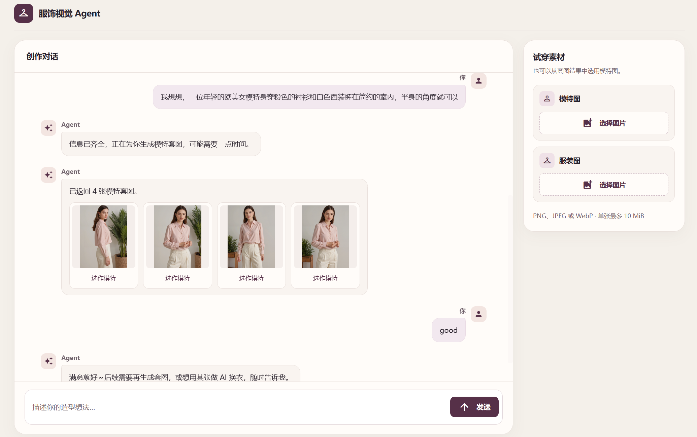
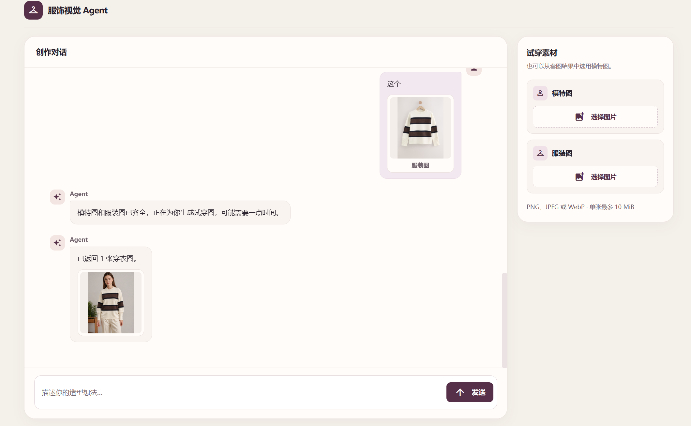

# Fashion Visual Agent

Fashion Visual Agent 是一个面向电商服饰的对话式视觉工作台原型。你可以用自然语言发起模特套图任务，也可以引用同一会话里的模特图，上传服装图继续试穿。

## 网页演示

> 截图展示网页交互，服饰图片为演示素材。当前仓库的图像工具返回占位 PNG，真实生图和虚拟试穿模型尚未接入。

### 1. 描述需求，查看四张套图

Agent 会追问缺少的人物、服装和场景信息。描述补齐后，四张结果图会显示在对话中，每张都可以选作试穿的模特图。



### 2. 引用第三张套图，上传服装图试穿

在对话里说「用刚刚生成的第三张模特图做试穿」，Agent 会沿用该图，只追问缺少的服装图。也可以分别上传模特图和服装图，发起独立的试穿任务。



<details>
<summary>查看追问和引用图片的对话</summary>

**补齐套图需求**


**复用同一会话里的图片**


</details>

## 本地运行

使用 Python 3.12。在项目根目录安装依赖。当前图像占位工具使用 Windows 微软雅黑字体 `msyh.ttc`。

```powershell
python -m pip install -e .
```

在项目根目录的 `.env` 文件中填写阿里云百炼 API 密钥。

```dotenv
DASHSCOPE_API_KEY=your_api_key
```

```powershell
python -m fashion_visual_agent.web
```

在浏览器打开 [本地工作台](http://127.0.0.1:8080)。支持上传 PNG、JPEG 和 WebP，单张最大 10 MiB，结果可在对话中预览和下载。也可以用 `fva-brain` 启动命令行对话。

## 实现要点

- **多轮任务规划**：千问通过 JSON Schema 返回回复和可选的执行计划。信息齐全后，Python 按计划调用一次图像工具，再把实际结果或错误交给模型生成最终答复。主流程见 [application.py](src/fashion_visual_agent/application.py)。
- **图片引用和会话隔离**：每个网页会话独立记录上传素材和工具结果。用户可以按序号引用历史图片，也可以直接点选。图片只在所属会话内可访问。会话逻辑见 [web_sessions.py](src/fashion_visual_agent/web_sessions.py)。
- **界面和图像工具**：网页使用 NiceGUI，图片访问通过 FastAPI 提供。套图和试穿共用图片结果结构，图像工具入口见 [generation.py](src/fashion_visual_agent/providers/image/generation.py)。
