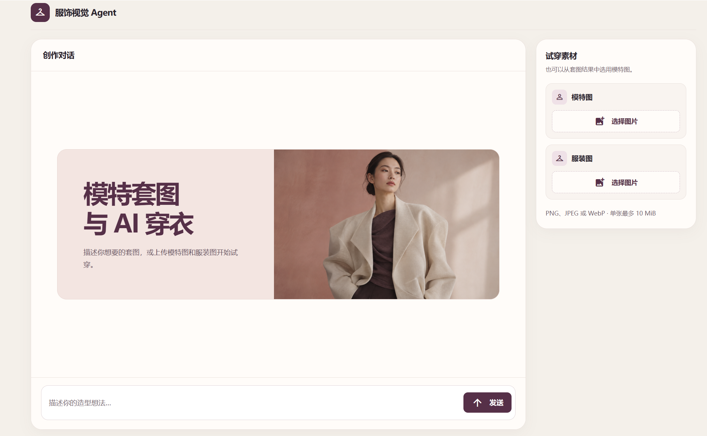
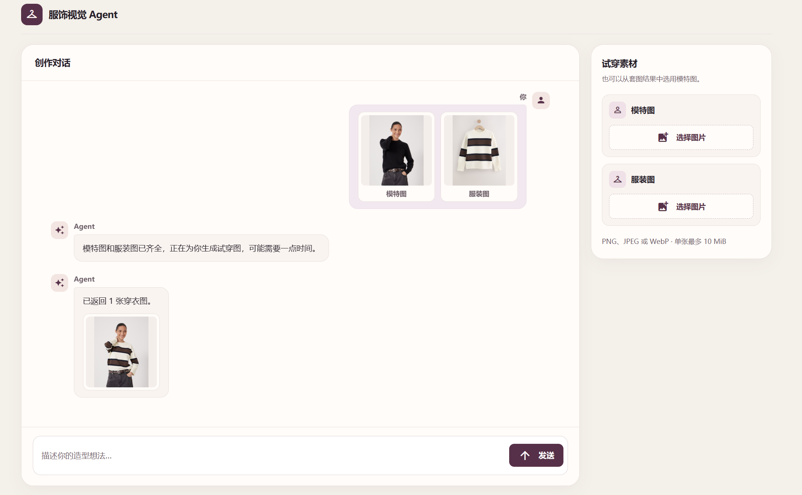
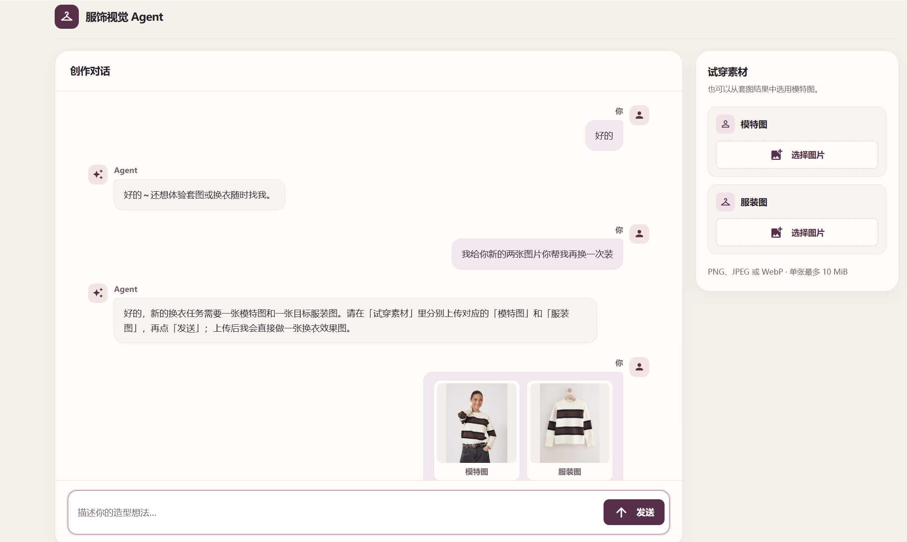
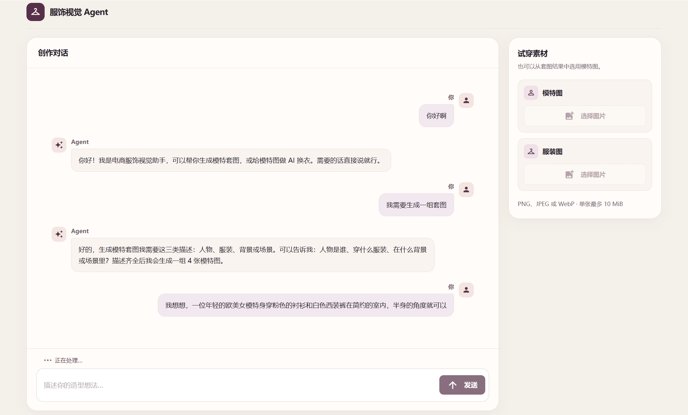
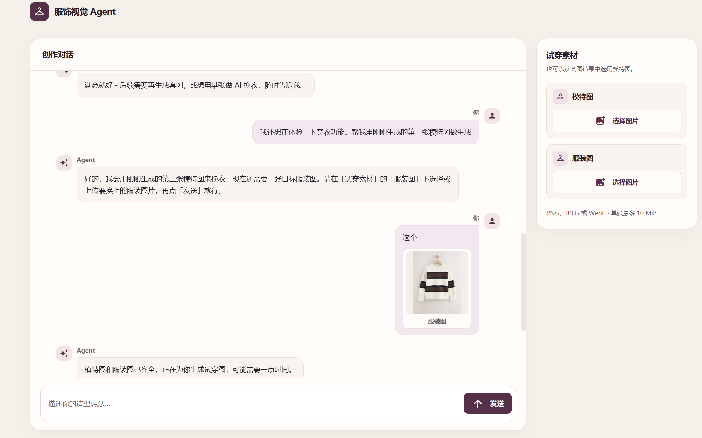

# Fashion Visual Agent

Fashion Visual Agent 是一个面向电商服饰的对话式视觉工作台原型。你可以在同一个对话框里发起 AI 换衣或模特套图生成。Agent 会提示你补充缺少的描述或图片，并在对话中展示结果。你也可以直接引用会话里的套图结果继续试穿。

## 网页演示

> 截图展示网页交互。当前仓库的图像工具返回占位 PNG，真实生图和虚拟试穿模型尚未接入。



### AI 换衣

在对话中提出换衣需求，在「试穿素材」中分别上传一张模特图和一张目标服装图，再点击「发送」。素材齐全后，Agent 会在对话中返回一张穿衣图。



<details>
<summary>查看如何发起独立换衣任务</summary>



</details>

### 模特套图生成

在对话中描述想要的人物、服装和场景。Agent 会追问缺少的信息，描述齐全后在对话中返回一组四张模特图。


<details>
<summary>查看如何补齐套图描述</summary>



</details>

### 用套图结果继续试穿

在同一对话中说「用刚刚生成的第三张模特图做试穿」，Agent 会沿用这张图，只提示补传目标服装图。也可以点某张套图下的「选作模特」，上传目标服装图后发送试穿请求。两种方式都省去了下载和重新上传模特图的步骤。


<details>
<summary>查看如何引用第三张套图</summary>



</details>

## 本地运行

使用 Python 3.12。在项目根目录安装依赖。当前图像占位工具使用 Windows 微软雅黑字体 `msyh.ttc`。

```powershell
python -m pip install -e .
```

在项目根目录的 `.env` 文件中填写阿里云百炼 API 密钥。

```dotenv
DASHSCOPE_API_KEY=your_api_key
```

```powershell
python -m fashion_visual_agent.web
```

在浏览器打开 [本地工作台](http://127.0.0.1:8080)。支持上传 PNG、JPEG 和 WebP，单张最大 10 MiB，结果可在对话中预览和下载。也可以用 `fva-brain` 启动命令行对话。

## 实现要点

- **多轮任务规划**：千问通过 JSON Schema 返回回复和可选的执行计划。信息齐全后，Python 按计划调用一次图像工具，再把实际结果或错误交给模型生成最终答复。主流程见 [application.py](src/fashion_visual_agent/application.py)。
- **图片引用和会话隔离**：每个网页会话独立记录上传素材和工具结果。用户可以按序号引用历史图片，也可以直接点选。图片只在所属会话内可访问。会话逻辑见 [web_sessions.py](src/fashion_visual_agent/web_sessions.py)。
- **界面和图像工具**：网页使用 NiceGUI，图片访问通过 FastAPI 提供。AI 换衣和套图生成共用图片结果结构，图像工具入口见 [generation.py](src/fashion_visual_agent/providers/image/generation.py)。
